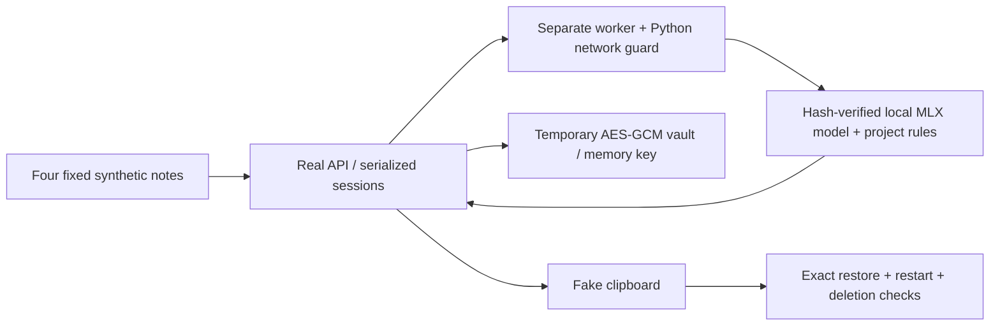

# Shipping-model runtime check — October 18, 2026

The pinned local MLX model, worker, API, and encrypted-vault path completed four
synthetic note round trips. A separate correctness defect in copied context was
fixed: names no longer cause an unsupported “boy” or “girl” claim.

**This is integration evidence, not clinical acceptance or a new recall score.**
The shipping model's historical gate4 failures remain. No real patient data,
clinical documents, external drafting service, or paid model call was used.

## Artifacts and environment

- Base source: `1b24f22aa8bb5390f6d604cd9ecfc7310133e74c`, plus the context fix here.
- Apple M4, 16 GiB RAM, macOS 26.6.2, arm64; Python 3.12.12.
- MLX and MLX Metal 0.32.3. [Exact environment](model-runtime-environment-20261018.txt).
- Disk free before download: **78,228,242,432 bytes**.
- Download: **1,520,328,946 bytes**, seven data files, all size/SHA-256 checks passed.
- Model: `OpenMed/privacy-filter-mlx-8bit`, revision
  `f244d23379e440f2a7ec9f0832c049d92a44295c`, Apache-2.0.
- Weight SHA-256: `22c4e8323b5a39bd6ab42b8cf9f8920f7676158b7375759d28d053616fbd7d6e`.
- BPE: the manifest-pinned `o200k_base.tiktoken` from OpenAI's public blob URL,
  SHA-256 `446a9538cb6c348e3516120d7c08b09f57c36495e2acfffe59a5bf8b0cfb1a2d`.

Hugging Face's revision metadata matched the project manifest. Its two published
LFS hashes matched the weight and tokenizer hashes. Every actual downloaded file
was then checked independently against its pinned size and hash; see the
[integrity receipt](model-runtime-integrity-20261018.json). Files remain in ignored
`models/` directories; weights are not committed.

Only manifest-listed safetensors, JSON, and BPE data were fetched. The local
backend loads safetensors strictly using vendored code pinned separately to
OpenMed commit `f6b27b0eb3c4dcfe8b6129995e0ed303744beca8`. No remote Python code or
`trust_remote_code` loader ran. No model or dependency lock changed.

MLX installed from cached locked wheels with network and source builds disabled.
The model-only environment lacked optional Mac document frameworks: the first
broader regression run had 13 dependency errors (`Quartz`/`CoreFoundation`),
752 passes, and 17 skips. A strict offline full-app install refused the source-only
`proxy-tools` dependency; no build hook ran. Only the three exact locked cached
PyObjC document-framework wheels were added. The broader suite then passed.
This does not establish a clean full-app installer or packaging run.

## Actual paths and fixed expectations



| Fixture | Listed values to hide | Text that must remain |
|---|---|---|
| Existing sample | Fictional child/family names, DOB, phone, daycare | `/k/`, `8/10`, `mod cues`, `92507` |
| Spanish sentence | Fictional name, phone, date, email | Exact round-trip source |
| Unicode name | Fictional accented name | Emoji, `/ɲ/`, `7/10` |
| Clinical-only text | No planted identifiers | `/k/`, `/s/`, `8/10`, `mod cues`, `92507` |

All listed values were hidden and required tokens retained. All four unedited
copies restored exactly, including after session-manager reload. The worker
restarted and reran its model self-test. The temporary vault did not contain
literal source notes; encryption format and tamper handling also remain covered
by the model-free suite. Deleting only those temporary sessions cleared history,
invalidated the old mapping, and allowed a new session.

The self-test reported model/BPE integrity, Python socket refusal, and the sample
note passing. Python socket refusal is **not** an OS-wide network-isolation trace.
Native clipboard, Keychain, hotkeys, and the window were not exercised. No device
permission was granted. See the [runtime receipt](model-runtime-20261018.json) for
all checks, tagged synthetic outputs, source/runner hashes, and diagnostic timings.
Those small-note timings are not a whole-app performance or memory benchmark.

## Verified defect and correction

`context_line()` previously guessed individual gender from SSA name-frequency
statistics. The normal app copy path supplied no explicit gender. It could add
“boy” to a note saying “she”, or “girl” to a note saying “he”.

| Synthetic source | Before: copied context | After: copied context |
|---|---|---|
| `Name: Mateo Ruiz` / `Age: 4;2. She practiced /k/.` | `[CHILD_1]: boy, 4;2.` | `[CHILD_1]: 4;2.` |
| `Name: Valentina Ruiz` / `Age: 4;2. He practiced /k/.` | `[CHILD_1]: girl, 4;2.` | `[CHILD_1]: 4;2.` |

The default now omits unknown gender. It does not guess from pronouns or names.
The existing explicit `gender=` argument, age/language context, original pronouns,
and stored contexts for previously issued copies remain supported. Both explicit
and default copies restore after serialization/reload. SPEC §4.4 now makes this
boundary explicit. Date tags intentionally retain years under the existing policy;
that behavior was observed and left intact.

Four focused regression cases failed before the fix and passed afterward.
The two existing implicit-gender expectations were updated; explicit-override,
multiple-copy, age-over-89 exclusion, and unrelated-metadata restore coverage remain.

## Runnable checks and results

```sh
# Fetch is a setup step; inspect the manifest before using network access.
.venv/bin/python tools/fetch_models.py --only pf-mlx-8bit o200k-bpe
.venv/bin/python tools/fetch_models.py --verify --only pf-mlx-8bit o200k-bpe

env -u SKIP_SLOW PYTHONPATH=src .venv/bin/python -m pytest -q tests/test_pf_model.py -k end_to_end_detects_planted_identifiers
PYTHONPATH=src .venv/bin/python tools/check_model_runtime.py --output /tmp/localdeid-model-new.json

SKIP_SLOW=1 PYTHONPATH=src .venv/bin/python -m pytest -q \
  --ignore=tests/test_finetune.py --ignore=tests/test_app_clipboard.py \
  --ignore=tests/test_app_hotkeys.py
```

- Integrity: **7/7 files passed**.
- Existing small direct-model test: **1 MLX pass, 1 absent-ONNX skip**. It covers
  planted name/phone/date/email spans, empty input, and Unicode offset bounds.
- Focused restore/regression files: **446 passed**.
- Broader synthetic suite: **765 passed, 17 skipped** with slow model matrices
  disabled and the three explicit exclusions above. Mac document tests ran.
- Actual model-backed worker/API/vault receipt: all recorded checks passed across
  the four fixed fixtures. Completion does not measure unseen-identifier recall.

## Remaining gates

1. Clinician-owned 30-document acceptance, without transferring clinical notes
   into this repository or external services.
2. Whole-app speed and peak memory on the actual 8 GB MacBook Air.
3. User-led native window, clipboard, Keychain, hotkey, and end-to-end workflow
   checks in an authorized interactive session.
4. Whole-process network-isolation observation and packaging/installer validation.

No spent gate4 set was retuned, fine-tuned weights were not loaded, and no
production-readiness or compliance claim follows from this run.
